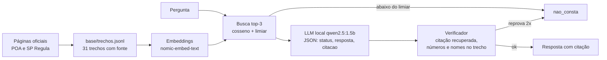

# Relatório – Assistente de Iluminação Pública (rua escura)

GS 2026.2 CitizenTech · Generative AI for Engineering

## 1. Integrantes
| Nome | RM |
|---|---|
| Guilherme Daher | 98611 |
| Gabriel Freitas | 550187 |
| Heitor Nobre | 551539 |
| Vinicius Yamashita | 550908 |
| Lucca Alexandre | 99700 |

## 2. Ficha Técnica
- **Problema (segurança):** rua escura aumenta o medo e o risco, e o cidadão não sabe a quem pedir o conserto, em quanto tempo isso deve ser atendido e por qual canal.
- **O que a IA resolve:** recebe a pergunta em texto livre e responde quem atende, o prazo e o canal, **citando o trecho oficial**. Se a base não cobre (outra cidade, assunto fora da base), responde "não consta".
- **Usuário:** cidadão e atendente de prefeitura. **Pagador possível:** prefeitura ou concessionária de iluminação, para reduzir chamadas repetidas e reclamações mal encaminhadas.
- **Saída:** JSON `{status, resposta, citacao}`.
- **LGPD:** a base é só informação pública oficial. O sistema não pede nem guarda dado pessoal. **Explicabilidade:** cada resposta mostra o trecho citado. **Humano no circuito:** a resposta é pré-orientação e a API devolve o aviso para confirmar no canal oficial.
- **Modelos locais:** `qwen2.5:1.5b-instruct` (geração) e `nomic-embed-text` (busca), via Ollama, em CPU de 2 núcleos, sem GPU.

## 3. Diagrama do pipeline

## 4. Tabela da base
| Fonte | Descrição | Formato | Licença | Trechos |
|---|---|---|---|---|
| F1 | Carta de Serviços da Prefeitura de Porto Alegre, 8 páginas de iluminação pública (apagada, oscilante, ausente, acesa de dia, pendurada, faiscando, obstruída, poste caído) | HTML (site oficial) | Informação pública de órgão oficial; uso com citação da fonte | 27 |
| F2 | SP Regula, "Entenda os tipos de não conformidades na iluminação pública" (São Paulo) | HTML (site oficial) | Informação pública de órgão oficial; uso com citação da fonte | 4 |

Limitações da base: as páginas de Porto Alegre constam como atualizadas em 10/08/2021; a tabela de tipos de não conformidade da SP Regula é uma imagem e não entrou; Rio de Janeiro bloqueou o acesso e Fortaleza não teve página localizada, então ficam fora e viram perguntas "não consta". Os trechos foram escritos a partir das páginas lidas em 09/11/2026.

## 5. Performance
**Conjunto de teste:** 40 perguntas com gabarito determinístico (expressões regulares com os fatos exigidos): 26 com resposta e 14 "não consta". Dez perguntas (dev) servem só para escolher o limiar; as 30 restantes (teste, 19 com resposta e 11 "não consta") foram usadas uma única vez, sem ajuste depois de ver o resultado.

**Busca (todas as 26 com resposta):** recall@1 = 0,615 e recall@3 = 0,962 (dev: 0,571 e 1,000; teste: 0,632 e 0,947).
**Limiar:** 0,7003, o maior valor que mantém todas as perguntas respondíveis do dev. Ele barra 27% das perguntas "não consta" do teste e 0% das do dev. **A similaridade quase não separa "não consta" de "com resposta"**, porque as perguntas fora da base ainda falam de iluminação pública e ficam parecidas com os trechos. Por isso a recusa fina é feita pelo modelo e pelo verificador.

**Placar (teste, 30 perguntas):**
| Configuração | Acertos | Com resposta (19) | Recusa correta (11) | JSON válido | Citação válida | Tempo médio |
|---|---|---|---|---|---|---|
| A. LLM sem contexto | 3/30 (10%) | 1/19 | 2/11 | 93% | 0% | 12,0 s |
| B. RAG simples | 25/30 (83%) | 17/19 | 8/11 | 100% | 82% | 8,5 s |
| C. Agente com verificador | 22/30 (73%) | 12/19 | 10/11 | 100% | 100% | 11,6 s |

**Interpretação.**
- **A alucina em quase tudo.** Sem contexto, inventa prazo, órgão e lei. Exemplos reais da execução: poste caído em Porto Alegre "24 horas" citando "Lei 1.124/2004" (a fonte diz até 6 horas); responsável "Conselho Municipal de Urbanismo (CMU)" (é a SMSURB); telefone da iluminação do Rio "(21) 3205-1000"; contrato de PPP "R$ 1,2 bilhão". Nenhuma citação existe na base. Em perguntas fora da base, respondeu como se soubesse.
- **B acerta mais** e é a mais precisa nas perguntas com resposta, mas erra de dois modos: responde perguntas fora da base com um trecho parecido (3 casos) e, em 3 respostas corretas, cita algo que não é um id da base (por exemplo `SP-regulamento`), o que prejudica a rastreabilidade.
- **C é a mais segura:** 100% das citações são ids reais da base, barra 10 de 11 perguntas "não consta" e nunca devolve JSON inválido. O custo é a recusa indevida em perguntas respondíveis (12/19 contra 17/19 do B). Em acurácia bruta, **C ficou 3 perguntas atrás de B**.
- Para um serviço público, uma resposta errada com aparência de oficial é pior que "não consta, ligue 156". Por isso C é a escolha para uso, mas ainda precisa de melhoria na recuperação.
- **Cuidado estatístico:** são 30 perguntas e a diferença entre B e C é de 3 perguntas. Isso indica uma tendência, não uma prova. A base e o gabarito foram escritos por quem já conhecia as páginas, o que tende a favorecer o resultado.

## 6. Os 5 erros reais, causa e correção
1. **q24, "A ligação para tirar dúvidas é gratuita?" (B e C recusaram).** *Causa:* falha de busca. O trecho `POA-contato-smsurb` ficou fora dos 3 primeiros (recall@3 falhou), porque a pergunta usa "ligação gratuita" e o trecho diz "0800 … (ligação gratuita)" em meio a outros telefones. *Correção:* busca híbrida (BM25 + embeddings) ou acrescentar ao trecho palavras como "gratuito" e "telefone".
2. **q17, "Que número ligar de outra cidade…" (B e C recusaram).** *Causa provável:* o trecho certo estava em 1º lugar, mas o prompt manda recusar perguntas "sobre outra cidade", e o modelo de 1,5 B confundiu "de outra cidade" com assunto de outra cidade. *Correção:* reescrever a regra de recusa ("recuse se a cidade perguntada não é Porto Alegre ou São Paulo"), usar exemplos no prompt ou um modelo maior.
3. **n05, "Quem é responsável em Curitiba?" (B respondeu SMSURB; também n09 e n11).** *Causa:* B só mede similaridade e não sabe que Curitiba não está na base, então devolve o trecho mais parecido de Porto Alegre. *Correção já aplicada no C:* o verificador exige que nomes próprios da pergunta apareçam no trecho citado, e C recusou. O n05 foi corrigido por C; **n09 ("A que horas os postes acendem?") não**, porque o número "06 horas" existe no trecho e o verificador não sabe que a pergunta é sobre horário. *Correção futura:* verificar se os termos centrais da pergunta ("acendem") aparecem no trecho, ou checagem de implicação por um segundo modelo.
4. **q10, prazo de luminária ausente (C recusou).** *Causa:* na 2ª tentativa o agente usa só o trecho de 1º lugar, e ali era `POA-ausente-descricao`, que não traz o prazo (o `…-prazo` estava em 2º lugar; recall@1 baixo, 0,62). *Correção:* na retentativa usar os 3 trechos ou o trecho de maior pontuação que contenha o assunto perguntado, e melhorar a busca para subir o trecho "prazo".
5. **q14, "Quem faz a manutenção na capital paulista?" (C respondeu o prazo de 24 h).** *Causa:* o 1º trecho foi `SP-prazo` e não `SP-responsavel`; o verificador confere citação, números e nomes, mas não se a resposta **responde a pergunta**. (Caso parecido: q12 citou `POA-poste-caido-descricao`, trecho sem a informação sobre PPP.) *Correção:* verificador de relevância (o trecho citado precisa conter os termos da pergunta) ou mais trechos de contexto.

## 7. Conclusão técnica
RAG com um modelo pequeno e local reduziu drasticamente a alucinação: de 10% de acertos sem contexto para 83% com RAG e 73% com o agente verificador, com citações rastreáveis. O verificador trocou cobertura por segurança, e a melhoria mais valiosa é a busca híbrida e uma retentativa melhor, não um modelo maior. Limitações: base de apenas duas cidades e de páginas de 2021 no caso de Porto Alegre; 30 perguntas de teste; ausência de LoRA (a especialização feita foi um agente com verificador, por não haver GPU). Próximos passos: busca híbrida, mais cidades, avaliação com perguntas escritas por pessoas de fora do grupo e revisão por um técnico da prefeitura.

- **Repositório:** _colar o link do GitHub_
- **Vídeo:** _colar o link do vídeo_
