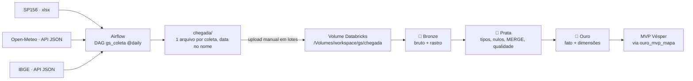

# 02 · Big Data — Pipeline de Dados do Vésper

Componente de **Dados** da Global Solution **CitizenTech** (FIAP). Constrói o pipeline que coleta dados reais do problema do **Vésper** (ruas escuras / iluminação pública), trata em camadas **Bronze → Prata → Ouro** e entrega ao MVP os indicadores que o cidadão e o órgão consultam.

---

## Integrantes

| Nome completo | RM |
| Guilherme Daher | 98611 |
| Gabriel Freitas | 550187 |
| Heitor Nobre | 551539 |
| Vinicius Yamashita | 550908 |
| Lucca Alexandre | 99700 |

---

## Perguntas que o pipeline responde

- Onde a cidade está no escuro agora? (chamados por região/distrito)
- Quanto tempo a falha leva até o conserto?
- Chamados por mil habitantes, **Centro × Periferia** (indicador de impacto social)

---

## Arquitetura do fluxo de dados



`Fontes → Airflow → chegada/ → Volume → Bronze → Prata → Ouro → MVP`

> O Databricks Free Edition **não conecta no Airflow**: os arquivos da pasta `chegada/` sobem ao Volume pela interface do Databricks, em lotes.

---

## Tabela de fontes

| Fonte | Tipo | O que traz | Formato | Frequência |
|---|---|---|---|---|
| **SP156** (Prefeitura de SP) | Base aberta | Chamados de iluminação ("Fiação e Postes") por região e data | `.xlsx` | Trimestral (base) / coleta diária |
| **Open-Meteo** | API pública, sem chave | Clima/anoitecer por dia (contexto de escuridão) | `.json` | Diária |
| **IBGE** | API pública | Municípios de SP (localidades) e **população por distrito** (Censo 2022, agregado 9923) | `.json` | Estática (referência) |

---

## Estrutura de pastas

```
02-big-data/
├── dags/              # DAG do Airflow (gs_coleta.py)
├── databricks/        # notebook do pipeline (gs_pipeline.ipynb: Bronze, Prata, Ouro, LGPD)
├── amostras/          # um pouco de cada fonte (poucos registros, sem dado pessoal real)
├── tests/             # pytest + requirements.txt
└── README.md
```

---

## Passo a passo para rodar

### 1. Coleta (Airflow)

```bash
cd 02-big-data/airflow      # pasta local do Airflow (fora do versionamento)
docker compose up -d        # sobe o Airflow 3 via Docker
```

- Acesse `http://localhost:8080`.
- Crie a **Airflow Variable** `sp156_url` com a URL direta do `.xlsx` do SP156 (nunca no código).
- Ative a DAG **`gs_coleta`** (`@daily`): 3 coletas em paralelo (`coletar_clima`, `coletar_ibge`, `coletar_sp156`) + `conferir_chegada`.
- Rode a DAG em **2 dias diferentes** para gerar 2 lotes em `chegada/` (`clima_{ds}.json`, `municipios_sp_{ds}.json`, `sp156_{ds}.xlsx`).

### 2. Carga no Volume (Databricks)

- Crie o Volume `/Volumes/workspace/gs/chegada` (catálogo `workspace`, schema `gs`).
- Suba os arquivos de `chegada/` pela interface do Databricks (**Catalog → workspace → gs → chegada → Upload**), em **2 lotes** de dias diferentes (prova do incremental).

### 3. Pipeline (notebook `databricks/gs_pipeline.ipynb`)

Rode as células na ordem:

1. **Bronze** — `bronze_sp156` (xlsx via pandas) + `bronze_clima`/`bronze_ibge` (COPY INTO, incremental e idempotente).
2. **Prata** — `prata_sp156` (tipos, nulos/inválidos, MERGE pela chave, 3 regras de qualidade).
3. **Ouro** — `ref_populacao_distrito` (IBGE) → `dim_local`, `dim_tempo`, `fato_chamado` → as 5 consultas SQL.
4. **LGPD / MVP** — `ouro_mvp_mapa` (tabela de consumo do MVP) + hash do endereço.

Catálogo/schema de todas as tabelas: **`workspace.gs`**.

---

## Camadas e tabelas geradas

| Camada | Tabela | Descrição |

| 🥉 Bronze | `bronze_sp156` | Chamados SP156 brutos + `arquivo_origem`, `carregado_em` |
| 🥉 Bronze | `bronze_clima` | Clima diário (COPY INTO incremental) |
| 🥉 Bronze | `bronze_ibge` | Municípios de SP (COPY INTO incremental) |
| 🥈 Prata | `prata_sp156` | Tipado, limpo, deduplicado por chave de negócio (`id_chamado`) |
| 🥇 Ouro | `fato_chamado` | Fato (1 chamado por linha): FKs de local e tempo + medidas |
| 🥇 Ouro | `dim_local` | Distrito, zona (Centro/Periferia), população (IBGE) |
| 🥇 Ouro | `dim_tempo` | Dia, mês, trimestre, dia da semana |
| 🥇 Ouro | `ouro_mvp_mapa` | Agregado por distrito que o **MVP consome** |

---

## As 5 consultas do MVP

1. Chamados por distrito (onde a cidade está no escuro)
2. Tempo médio da falha até o conserto
3. Evolução de chamados por mês
4. % de chamados válidos vs. descartados
5. **Impacto:** chamados por mil habitantes, Centro × Periferia (junta o fato com o IBGE)

---

## LGPD e integração com o MVP

- O SP156 **não traz dados pessoais** do solicitante (nome/telefone/e-mail). O quase-identificador (endereço) fica **fora da Ouro** e é **hasheado** (`sha2`) quando necessário.
- A Ouro entrega **agregados por distrito**, nunca o indivíduo — alinhado ao discurso do Vésper ("sem cadastro, sem guardar a foto").
- **Contrato de consumo do MVP:** a tabela **`ouro_mvp_mapa`** (`distrito`, `zona`, `populacao`, `chamados`, `chamados_por_mil_hab`, `tempo_medio_dias`, `pct_finalizado`). A tela **Central** do MVP exibe os chamados por região (mapa + lista), que é o consumo previsto dessa tabela.

---

## Reprodutibilidade

- Repositório **público** e no ar durante a correção.
- **Nunca** versionar `.env`, chave de API, senha, dataset pesado ou arquivo acima de 10 MB.
- `amostras/` contém poucos registros de cada fonte para o avaliador testar sem acesso às chaves.