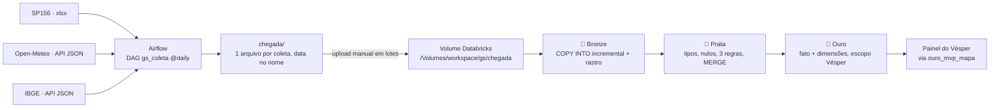

# 02 · Big Data — Pipeline de Dados do Vésper

Componente de **Dados** da Global Solution **CitizenTech** (FIAP). O Vésper é uma proposta de produto para ruas escuras; este pipeline usa **dados públicos reais** para dimensionar o problema. Ele coleta as fontes no Airflow, trata em camadas **Bronze → Prata → Ouro** no Databricks e entrega a tabela de indicadores que o painel do Vésper exibe.

---

## Integrantes

| Nome completo | RM |
|---|---|
| Guilherme Daher | 98611 |
| Gabriel Freitas | 550187 |
| Heitor Nobre | 551539 |
| Vinicius Yamashita | 550908 |
| Lucca Alexandre | 99700 |

---

## Perguntas que o pipeline responde

- Onde a cidade está no escuro? (chamados de poste/fiação por distrito)
- Quanto tempo a falha leva até o fechamento do chamado?
- Chamados por mil habitantes, **Centro × Periferia** (indicador de impacto social)

### Escopo Vésper

A base aberta do SP156 (3º trimestre de 2026) **não tem serviço de lâmpada apagada**. Usamos os chamados de **poste e fiação** como indicador da infraestrutura de iluminação: `Denunciar Fiação solta na calçada` e `Denunciar Poste em mau estado` (lista em `ESCOPO_SERVICOS`, célula CONFIG do notebook). Essa lacuna é a que a proposta do Vésper quer cobrir: o relato do cidadão sobre a rua escura.

---

## Arquitetura do fluxo de dados



`Fontes → Airflow → chegada/ → Volume → Bronze → Prata → Ouro → Painel`

> O Databricks Free Edition **não conecta no Airflow**: os arquivos da pasta `chegada/` sobem ao Volume pela interface do Databricks, em lotes.

---

## Tabela de fontes

| Fonte | Tipo | O que traz | Formato | Frequência |
|---|---|---|---|---|
| **SP156** (Prefeitura de SP) | Base aberta | Chamados ao 156 por serviço, data, status e distrito (usamos poste e fiação) | `.xlsx` | Base trimestral · coleta diária |
| **Open-Meteo** | API pública, sem chave | Clima horário de SP (contexto de escuridão e chuva) | `.json` | Diária |
| **IBGE** | API pública | Municípios de SP e **população por distrito** (Censo 2022, agregado 9923) | `.json` | Estática (referência) |

---

## Estrutura de pastas

```
02-big-data/
├── dags/              # DAG do Airflow (gs_coleta.py)
├── databricks/        # gs_pipeline.ipynb (Bronze, Prata, Ouro, consultas, LGPD) + vesper_indicadores_ouro.lvdash.json (painel)
├── mongodb/           # não usado (opcional no enunciado)
├── amostras/          # poucos registros de cada fonte + ouro_mvp_mapa.json (sem dado pessoal)
├── tests/             # pytest + requirements.txt (o CI roda)
└── README.md
```

---

## Passo a passo para rodar

### 1. Coleta (Airflow 3)

```bash
mkdir -p 02-big-data/airflow && cd 02-big-data/airflow     # pasta local, fora do git
curl -LfO 'https://airflow.apache.org/docs/apache-airflow/stable/docker-compose.yaml'
# no bloco x-airflow-common > volumes, troque a linha dos dags e acrescente a chegada:
#   - ../dags:/opt/airflow/dags
#   - ./chegada:/opt/airflow/chegada
echo "AIRFLOW_UID=$(id -u)" > .env
docker compose up airflow-init && docker compose up -d     # http://localhost:8080
```

- Em **Admin → Variables**, crie `sp156_url` (URL direta do `.xlsx` do SP156) e, se quiser aviso no Discord/Teams, `webhook_alerta`. Nada disso vai no código.
- Ative o DAG **`gs_coleta`** (`@daily`): `inicio` → 3 coletas em paralelo (`coletar_clima`, `coletar_ibge`, `coletar_sp156`) → `conferir_chegada`.
- **Notificação:** falha em qualquer tarefa (após 2 tentativas) e lote completo geram aviso no log e no `webhook_alerta`, se existir.
- Rode o DAG em **2 dias diferentes** para gerar 2 lotes em `chegada/` (`clima_{ds}.json`, `municipios_sp_{ds}.json`, `sp156_{ds}.xlsx`).

### 2. Carga no Volume (Databricks)

- Crie o Volume `/Volumes/workspace/gs/chegada` (catálogo `workspace`, schema `gs`).
- Suba os arquivos de `chegada/` pela interface (**Catalog → workspace → gs → chegada → Upload**), em **2 lotes** de dias diferentes. O DAG grava em subpastas (`clima/`, `ibge/`, `sp156/`); no Volume os arquivos ficam **soltos na raiz**.

### 3. Pipeline (notebook `databricks/gs_pipeline.ipynb`)

Rode de cima para baixo:

1. `%pip install openpyxl` + reinício do Python → **CONFIG** (caminhos e `ESCOPO_SERVICOS`).
2. **Bronze** — cada `.xlsx` novo vira um `.csv` de pouso (só formato) e as 3 fontes entram por **COPY INTO**, com `arquivo_origem` e `carregado_em`.
3. **Prova do incremental** — na 1ª execução refaz a Bronze em 3 etapas (só lote 1 → lote 2 → reexecução) e grava as contagens em `controle_contagens`; depois disso só faz a carga incremental.
4. **Prata** — nulos, chave sem colisão, tipos, 3 regras que barram (contagem em `controle_qualidade`, linhas em `prata_sp156_rejeitados`) e **MERGE** pela chave.
5. **Ouro** — `ref_populacao_distrito` (IBGE) → `dim_local` → `dim_tempo` + `fato_chamado` (só escopo, endereço como hash).
6. **Q1–Q5** — cada consulta imprime a sua frase de leitura.
7. **`ouro_mvp_mapa`** — tabela de consumo do painel + JSON em `/Volumes/workspace/gs/saida/`.

### 4. Painel

Em **Workspace → Import**, importe `databricks/vesper_indicadores_ouro.lvdash.json` e clique em **Publish**. O painel lê só a `workspace.gs.ouro_mvp_mapa`.

Catálogo/schema de todas as tabelas: **`workspace.gs`**.

---

## Camadas e tabelas geradas

| Camada | Tabela | Descrição |
|---|---|---|
| 🥉 Bronze | `bronze_sp156` | Chamados SP156 brutos (texto) + `arquivo_origem`, `carregado_em` (COPY INTO) |
| 🥉 Bronze | `bronze_clima` | Clima horário (COPY INTO) |
| 🥉 Bronze | `bronze_ibge` | Municípios de SP (COPY INTO) |
| Controle | `controle_contagens` | Contagens da Bronze antes/depois do 2º lote e da reexecução |
| 🥈 Prata | `prata_sp156` | Tipado, limpo, `id_chamado` sem colisão, `escopo_vesper`; MERGE pela chave |
| 🥈 Prata | `prata_sp156_rejeitados` | Linhas barradas, com o `motivo` |
| Controle | `controle_qualidade` | Avaliadas × barradas por regra |
| 🥇 Ouro | `fato_chamado` | 1 chamado de poste/fiação por linha: FKs de local e tempo, medidas, `endereco_hash` |
| 🥇 Ouro | `dim_local` | Distrito, zona (Centro = 8 distritos da Subprefeitura da Sé), população IBGE 2022 |
| 🥇 Ouro | `dim_tempo` | Dia, mês, trimestre, dia da semana |
| 🥇 Ouro | `ouro_mvp_mapa` | Agregado por distrito que o **painel do Vésper consome** |

---

## Regras de qualidade da Prata

| Regra | O que barra |
|---|---|
| R1 · data de abertura válida | Data nula, futura ou antes de 2020 |
| R2 · fim depois do início | `data_de_finalizacao` anterior à `data_de_abertura` |
| R3 · distrito preenchido | Chamado sem distrito (não pode ser contado por região na Ouro) |
| Tratamento (não barra) | Coordenada fora da caixa de SP vira nula |

---

## As 5 consultas

1. Chamados de poste/fiação por distrito (onde a cidade está no escuro)
2. Tempo da abertura até o fechamento do chamado (média, mediana e p90)
3. Evolução de chamados por mês
4. % de chamados válidos vs. descartados pelas regras
5. **Impacto:** chamados por mil (e por 100 mil) habitantes, Centro × Periferia (fato + IBGE)

---

## LGPD e contrato com o produto

- O SP156 **não traz dados pessoais** do solicitante (nome/telefone/e-mail). O quase-identificador (endereço) entra na Ouro **só como `endereco_hash`** (SHA-256).
- A Ouro entrega **agregados por distrito**, nunca o indivíduo, alinhado ao Vésper ("sem cadastro, sem guardar a foto").
- **Contrato:** tabela **`workspace.gs.ouro_mvp_mapa`** · colunas `distrito, zona, populacao, chamados, chamados_por_mil_hab, chamados_por_100mil_hab, tempo_medio_dias, pct_finalizado, lat, lon` · JSON com 1 objeto por distrito (exemplo em `amostras/ouro_mvp_mapa.json`), atualizado a cada execução. O painel "Vésper — Indicadores da Ouro" (Dashboard do Databricks) é a tela que exibe esses dados.

---

## Resultados (execução de 17/11/2026)

| Etapa | Resultado |
|---|---|
| Bronze `bronze_sp156` | 484.232 linhas (lote 1) → 968.464 (lote 2) → 968.464 (reexecução: não duplica) |
| Prata | 484.232 chamados distintos avaliados · 302.923 aprovados · 181.309 barrados por R3 (sem distrito) · MERGE reexecutado: 302.923 → 302.923 |
| Ouro `fato_chamado` | 1.113 chamados de poste/fiação, todos com distrito do IBGE |
| Q1 | Jabaquara lidera (34 chamados, 3,1%); os 10 primeiros distritos somam 25,3% |
| Q2 | Mediana de 11 dias até o fechamento; média 18,1; 10% passam de 41 dias (119 finalizados) |
| Q3 | 315 (jul) → 354 (ago) → 444 (set): +41% |
| Q4 | 62,6% da base SP156 passa nas 3 regras; no escopo, 100% |
| Q5 (impacto) | Centro 16,3 vs Periferia 9,5 chamados por 100 mil hab. (1,7×) |

## Reprodutibilidade

- Repositório **público** e no ar durante a correção.
- **Nunca** versionar `.env`, chave de API, URL de webhook, senha, dataset pesado ou arquivo acima de 10 MB.
- `amostras/` tem poucos registros de cada fonte para o avaliador testar sem acesso às chaves; `python -m pytest -q` dentro de `02-big-data/` valida as amostras e o DAG.
