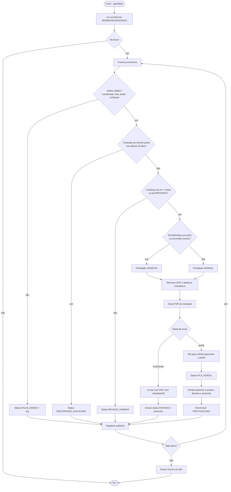

# PDD - Despachante de chamados de iluminação

> Documento de Definição de Processo. Use este arquivo como base do item "Descrição do processo e desenho do fluxo" do relatório (e desenhe o BPMN em bpmn.io/draw.io a partir do diagrama abaixo).

## 1. Contexto

- **Produto (CitizenTech):** priorização de ruas escuras por risco (segurança e mobilidade).
- **Cidadão beneficiado:** quem circula à noite por ruas mal iluminadas, especialmente perto de escolas e pontos de ônibus.
- **Problema operacional que o robô resolve:** hoje alguém teria que abrir a tabela de ocorrências, conferir cada uma, montar o chamado e enviá-lo à prefeitura manualmente. O robô faz esse caminho sozinho e deixa só os casos duvidosos para uma pessoa.

## 2. Entradas e saídas

| | Descrição |
|---|---|
| **Entrada** | Tabela de ocorrências (camada Ouro; aqui `data/ocorrencias.csv`) com status `PENDENTE` ou `APROVADO`, e a foto de cada ocorrência |
| **Saídas** | PDF do chamado, e-mail (ou item na fila do portal), status e protocolo gravados de volta na tabela, log, auditoria e resumo no n8n |

## 3. Fluxo

## 4. Regras de negócio

| Regra | Condição | Resultado |
|---|---|---|
| R1 Dados | `poste_id`, latitude/longitude válidas, foto existente, confiança entre 0 e 1 | senão `FALHA_DADOS` |
| R2 Duplicidade | outro chamado `ENVIADO`/`FILA_PORTAL`/`PROTOCOLADO` do mesmo poste em até 30 dias | `DESCARTADO_DUPLICADO` |
| R3 Revisão humana | confiança da IA < 0,70 e status diferente de `APROVADO` | `REVISAO_HUMANA` |
| R4 Prioridade | escola próxima, ponto de ônibus próximo ou severidade `severa` | `URGENTE`; senão `NORMAL` |

Limiar, janela de duplicidade e prazos sugeridos são configuráveis (`.env` / `src/config.py`). Os valores padrão são propostas do grupo, não regra oficial.

## 5. Exceções e resiliência

| Falha | Tratamento |
|---|---|
| Dado inválido ou foto ausente | item marcado `FALHA_DADOS`, motivo no log, lote continua |
| SMTP/portal fora do ar | retry com backoff exponencial (3 tentativas); se esgotar, item `ERRO` e lote continua |
| Exceção inesperada | capturada por item, com stack trace no `robo.log`, item `ERRO` |
| n8n fora do ar | erro logado; o robô não falha por causa da notificação |
| Queda no meio do lote | CSV salvo a cada item, de forma atômica; reexecutar não duplica (idempotente) |

## 6. Logs e auditoria

- `logs/robo.log`: log técnico com data/hora, nível e mensagem.
- `logs/auditoria.csv`: uma linha por decisão, com `timestamp, execucao_id, ocorrencia_id, acao, resultado, detalhe`. Não contém dados pessoais.

## 7. Segurança e LGPD

- Credenciais só em `.env` (fora do Git).
- A foto anexada é reencodada, o que remove EXIF/GPS, e passa por desfoque de rostos e placas quando o OpenCV com cascatas está disponível. O ideal é a visão computacional do grupo (YOLO) já entregar a foto anonimizada.
- O chamado leva só o necessário: poste, coordenadas, foto e análise da IA. Nada sobre quem fez o registro.

## 8. Integração com o MVP

O robô lê a tabela que alimenta o MVP e escreve de volta `status`, `prioridade`, `protocolo` e `data_envio`. O dashboard do MVP exibe o andamento de cada chamado a partir dessas colunas.

## 9. Testes (sucesso, decisão e falha)

`pytest` cobre 18 casos, entre eles: envio normal, urgente por escola/ônibus/escuridão severa, duplicado dentro e fora da janela, dados inválidos, baixa confiança, aprovação humana, falha de SMTP com lote que continua, retry com recuperação, reexecução idempotente e dry-run.
