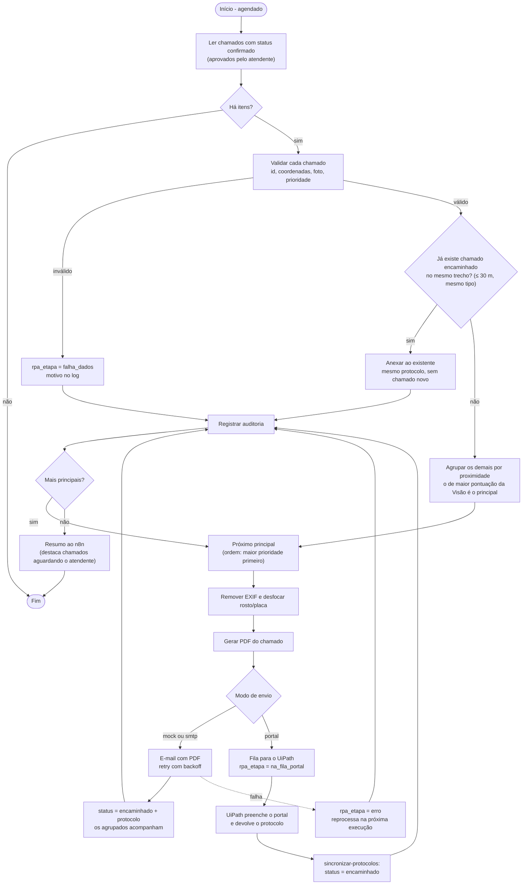

# PDD - Despachante de chamados de iluminação

> Documento de Definição de Processo do componente **05 RPA**. Serve de base para o item "Descrição do processo e desenho do fluxo" do relatório (desenhe o BPMN em bpmn.io ou draw.io a partir do diagrama da seção 3).

## 1. Contexto

- **Produto (CitizenTech):** ponte entre o cidadão e a prefeitura para ruas escuras e com iluminação pública falha.
- **Problema operacional que o robô resolve:** depois que a Visão valida a foto e o atendente confirma o chamado, alguém teria que abrir cada um, juntar os que são do mesmo poste, montar o documento e registrar na prefeitura. O robô faz esse caminho sozinho e registra tudo em log.
- **Contrato com o grupo:** [`docs/arquitetura.md`](../../docs/arquitetura.md) (RPA: "pega chamados confirmados, agrupa duplicados por proximidade, registra no sistema da prefeitura e atualiza o status, com logs") e [`04-visao-computacional/docs/integracao.md`](../../04-visao-computacional/docs/integracao.md) (JSON da Visão v1.1).

## 2. Ciclo de vida do chamado e o papel do robô

`recebido` → `validado` (Visão) → `confirmado` (atendente) → **`encaminhado` (RPA)** → `em_reparo` → `resolvido`, ou `recusado` com motivo.

| Status | Quem muda | O que o robô faz |
|---|---|---|
| `recebido`, `validado` | Visão / backend | Não processa. Os `validado` são contados como "aguardando o atendente" e aparecem no alerta do n8n |
| `confirmado` | atendente | **Entrada do robô** |
| `encaminhado` | **robô** | **Saída do robô**, junto com o protocolo e a data |
| `em_reparo`, `resolvido` | prefeitura / backend | Não altera. `em_reparo` conta como "já encaminhado" no agrupamento; `resolvido`, não |
| `recusado` | Visão / atendente | Ignora |

A decisão humana fica **antes** do robô: só entra na fila o que o atendente confirmou.

Além do `status` (compartilhado com o app), o robô guarda sua etapa interna na coluna `rpa_etapa`: `enviado`, `na_fila_portal`, `protocolado`, `agrupado`, `falha_dados` ou `erro`.

## 3. Fluxo

## 4. Dados de entrada (contrato da Visão v1.1)

O robô lê uma linha por chamado. As colunas vêm do JSON da Visão (`src/contrato.py` faz o mapeamento; `scripts/importar_visao.py` converte JSON em linhas):

| Campo do JSON da Visão | Coluna | Uso no robô |
|---|---|---|
| `id_captura` | `id_captura` | identifica o chamado (também nome do PDF) |
| `localizacao.latitude/longitude` | `latitude`, `longitude` | validação, agrupamento por distância, link do mapa |
| `prioridade.nivel` / `.pontuacao` | `prioridade_nivel`, `prioridade_pontuacao` | ordena a fila, define o prazo sugerido |
| `prioridade.fatores`, `validacao.motivos` | `fatores`, `motivos` | explicação no PDF e no portal |
| `fusao.tipos_chamado` | `tipos_chamado` | setor responsável; só chamados de tipo em comum se agrupam |
| `fusao.confirmacao` | `confirmacao` | registrado no PDF (sensor + foto) |
| `resumo.status_trecho`, `.postes_apagados` | `status_trecho`, `postes_apagados` | descrição do chamado |
| `sensor_lux`, `origem`, `timestamp` | `sensor_lux`, `origem`, `timestamp` | PDF e desempate da ordem |
| `modelo.nome/versao` | `modelo` | auditoria: qual modelo decidiu |
| `imagem_anonimizada_base64` | `foto` | foto do chamado (a Visão não armazena imagem) |

## 5. Regras de negócio

| Regra | Condição | Resultado |
|---|---|---|
| R1 Fila | `status = confirmado` e `rpa_etapa` vazia ou `erro` | entra no lote |
| R2 Dados | id seguro, latitude/longitude válidas, foto existente dentro de `data/`, `prioridade_nivel` ∈ {alta, media, baixa} | senão `rpa_etapa = falha_dados` e o motivo vai para o log |
| R3 Agrupamento | a no máximo 30 m e com ao menos um tipo em comum (poste e buraco na mesma rua não se juntam) | o de maior pontuação é o principal; os demais viram `agrupado` e acompanham o protocolo dele |
| R4 Já encaminhado | principal existente `encaminhado`, `em_reparo` ou na fila do portal, nos últimos 30 dias, no mesmo trecho | o novo chamado é anexado a ele, sem abrir outro |
| R5 Ordem e prazo | pontuação da Visão, da maior para a menor; prazo sugerido: alta 48 horas, média 7 dias, baixa 15 dias | |

Raio, janela, tentativas e prazos são configuráveis (`.env` e `src/config.py`). Os valores padrão (30 m, 30 dias, prazos) são propostas do grupo, não regra oficial.

## 6. Exceções e resiliência

| Falha | Tratamento |
|---|---|
| Dado inválido, coordenada ou foto ausente | `rpa_etapa = falha_dados` com o motivo; o lote continua. Corrigido o dado, basta limpar `rpa_etapa` para o chamado voltar à fila |
| SMTP ou portal fora do ar | retry com backoff exponencial (3 tentativas); se esgotar, o principal fica `erro` e volta à fila na próxima execução. Os agrupados dele não ficam órfãos: continuam na fila |
| Exceção inesperada | capturada por item, com stack trace no `robo.log`; o lote continua |
| n8n fora do ar | erro logado; o robô não falha por causa da notificação |
| Queda no meio do lote | a tabela é salva a cada item, de forma atômica; reexecutar não reenvia nada (idempotente) |

## 7. Logs e auditoria

- `logs/robo.log`: log técnico com data/hora, nível e mensagem.
- `logs/auditoria.csv`: uma linha por decisão (`timestamp, execucao_id, id_captura, acao, resultado, detalhe`). Não contém dados pessoais.

## 8. Segurança e LGPD

- Credenciais só em `.env` (fora do Git).
- A Visão já borra rostos e descarta o EXIF antes de devolver a foto. O robô reencoda a imagem (remove EXIF e GPS de novo) e, com OpenCV disponível, desfoca rostos e placas como segunda barreira.
- O PDF leva só o necessário: local, prioridade, análise e foto. Nada sobre quem fez o registro.
- `id_captura` e o caminho da foto são validados antes de virarem nome de arquivo (sem `../`).

## 9. Integração com o MVP

O robô lê a tabela de chamados e escreve de volta `status`, `protocolo`, `data_encaminhamento`, `rpa_etapa`, `chamado_principal` e `chamado_pdf`. O app do cidadão mostra a mudança de `confirmado` para `encaminhado`. Hoje a tabela é um CSV; quando o backend existir, só `ler` e `salvar` em `src/repositorio.py` mudam.

## 10. Testes (sucesso, decisão e falha)

`pytest` roda 46 casos, entre eles: fluxo completo com 10 chamados, ordem pela prioridade da Visão, agrupamento por proximidade (dentro e fora do raio, tipos diferentes, tipo em comum), anexo a chamado já encaminhado (dentro e fora da janela), dados inválidos, `id_captura` com caminho, falha de SMTP com recuperação no reenvio, reexecução idempotente, dry-run, modo portal com sincronização e conversão do JSON da Visão.
