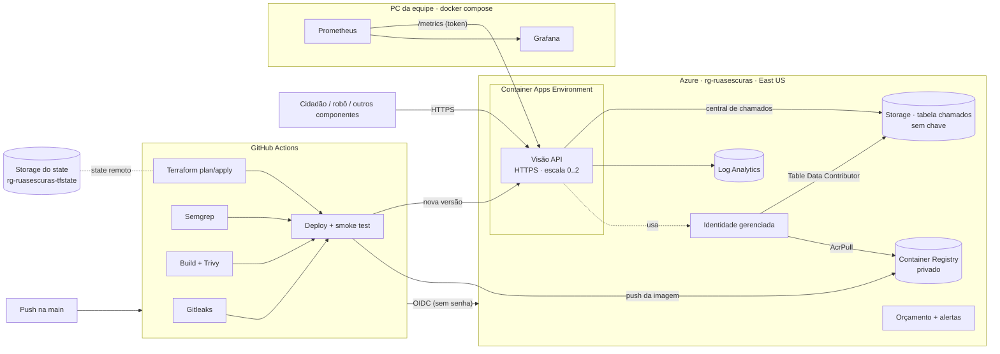

# DevOps e Cloud · Deploy Blindado

**Professores:** Gabriel Henrique Boyczuk Arcanjo e Cleórbete Santos

**Responsável:** Guilherme Gonçalves Calil Daher · RM 98611

**URL pública do MVP:** https://ca-ruasescuras-visao.bravehill-24590cb4.eastus.azurecontainerapps.io/docs · **Vídeo:** _(link)_

O MVP Ruas Escuras vai para a nuvem **sem ninguém clicar em botão**: cada push na `main` passa por um pipeline que
barra segredo vazado, código inseguro e dependência vulnerável; só então publica na Azure, em infraestrutura
criada por Terraform, e o Grafana mostra a saúde do sistema com as 4 métricas de ouro.

| Critério (14 pts) | Onde está |
|---|---|
| **Container e IaC (5)** | [`../04-visao-computacional/Dockerfile`](../04-visao-computacional/Dockerfile) (slim, não root, sem segredo) · [`docker-compose.yml`](docker-compose.yml) · [`terraform/`](terraform/) (state remoto, `.tfvars` fora do Git, **sem porta de administração**) |
| **Pipeline DevSecOps (4)** | [`../.github/workflows/06-devops-cloud.yml`](../.github/workflows/06-devops-cloud.yml): Gitleaks, Semgrep, build, Trivy, Terraform e deploy, com OIDC |
| **Observabilidade (3)** | [`observabilidade/`](observabilidade/): Prometheus + Grafana, 4 métricas de ouro + produto, 5 alertas |
| **Documentação (2)** | este README · [`docs/custo.md`](docs/custo.md) |

## Arquitetura



**Por que Container Apps:** é serverless. Não existe VM, logo **não existe porta de administração** (SSH/RDP) para
ficar exposta; a única entrada é HTTPS 443 com certificado gerenciado. Escala a zero quando ninguém usa (custo ~0)
e sobe sozinho com o tráfego.

**Por que o ambiente é criado pelo `azapi`:** em nov/2026 a Azure passou a criar ambientes novos no modo
**Express** (preview) quando o pedido não diz o modo. Nesse modo a configuração de registro privado é ignorada e o
container não consegue puxar a imagem do ACR com identidade gerenciada (erro `BuildFailed ... registryCredentials`).
O provedor `azurerm` 4.x ainda não tem o campo `environmentMode`, então o ambiente é declarado pelo `azapi`
(provedor oficial da Microsoft para a API mais nova) com `environmentMode = "WorkloadProfiles"` e o perfil
`Consumption`, que continua serverless e escala a zero. Diagnóstico registrado no histórico do PR #10.

**Divisão Terraform × pipeline:** o Terraform cria e mantém a infraestrutura; a **versão** em produção é trocada pelo
pipeline (`az containerapp update`). O Terraform ignora a imagem depois de criada, então um `terraform apply`
nunca volta a produção para uma versão antiga.

## Segurança em camadas

| Camada | Medida |
|---|---|
| Código | **Gitleaks** em todos os commits do push/PR · **Semgrep** (Python, Dockerfile, Terraform, segredos) |
| Dependências | **Trivy** na imagem (barra HIGH/CRITICAL com correção) e na configuração do Terraform |
| Imagem | `python:3.11-slim`, pacotes do SO atualizados no build, **usuário sem privilégios** (uid 10001), sem segredo, healthcheck |
| Acesso à nuvem | **OIDC**: o GitHub prova quem é a cada execução; nenhuma senha guardada. A identidade do pipeline tem **Contributor só no grupo da aplicação** e não pode conceder permissões |
| Registro de imagens | ACR **privado**, sem usuário admin; o container puxa a imagem com **identidade gerenciada** (AcrPull) |
| Central de chamados | Azure Table numa Storage **sem chave compartilhada**; o container escreve com a **identidade gerenciada** (papel só nesta conta). Guarda só tipo, prioridade, local e status: **nunca foto nem vídeo** |
| State do Terraform | Storage **sem chave compartilhada** (só login Entra ID), TLS 1.2, versionado, fora do repositório |
| Execução | HTTPS obrigatório; `/metrics` protegido por token; no compose: `read_only`, `cap_drop: ALL`, `no-new-privileges` |
| Custo | escala a zero, teto de réplicas, cota diária de logs, orçamento com alertas ([custo](docs/custo.md)) |

## Responsabilidade compartilhada

| Quem | Cuida de |
|---|---|
| **Microsoft (Azure)** | datacenter, hardware, rede física, hypervisor, sistema operacional dos nós do Container Apps, patch da plataforma, certificado TLS do domínio `azurecontainerapps.io`, disponibilidade do serviço |
| **Equipe** | código da aplicação e suas dependências, imagem do container (base, pacotes, usuário), configuração (Terraform), quem acessa (RBAC/OIDC), segredos, dados que trafegam e os logs que geramos, monitoramento e resposta a alertas |

## LGPD: onde ficam os dados pessoais

| Dado | Onde | Tratamento |
|---|---|---|
| Foto do cidadão | memória do container, só durante a análise | **não é armazenada**; rostos borrados antes de qualquer retorno; EXIF descartado |
| Localização (GPS) | resposta da API | usada para o chamado; **não vai para métricas nem logs** |
| Métricas | Prometheus | só contagens agregadas (rota pelo molde, tipo e prioridade do chamado): **nenhum dado pessoal** |
| Logs | Log Analytics (30 dias) | logs de acesso do container; sem corpo de requisição |
| E-mail de alerta de custo | variável sensível do Terraform / secret `ALERTA_EMAIL` | fora do Git |
| State do Terraform | Storage privado | contém nomes de recursos e o e-mail de alerta; acesso só por Entra ID |

## Como reproduzir

### 1. Local (tudo integrado + monitoramento)
```bash
cd 06-devops-cloud
copy .env.example .env                 # Linux/Mac: cp. Troque GRAFANA_SENHA.
docker compose up -d --build           # 1ª vez baixa ~1,3 GB de modelos do GenAI
```
Visão: http://localhost:8000/docs · GenAI: http://localhost:8001/docs · Prometheus: http://localhost:9090 ·
Grafana: http://localhost:3000 (painel **Ruas Escuras · 4 métricas de ouro**).

Disparar um alerta de propósito (evidência): `docker compose stop visao` → em ~1 min **VisaoForaDoAr** fica
*firing* em http://localhost:9090/alerts. `docker compose start visao` resolve.

### 2. Nuvem (uma vez, por quem é Owner da assinatura)
```powershell
az login
./scripts/bootstrap-azure.ps1 -SubscriptionId <id> -Repo <usuario>/<repo>   # state + identidade OIDC
cd terraform
copy terraform.tfvars.example terraform.tfvars                              # seu e-mail para alertas de custo
terraform init -backend-config="resource_group_name=rg-ruasescuras-tfstate" -backend-config="storage_account_name=<saída do bootstrap>"
terraform apply                                                             # 1º apply: cria os papéis AcrPull e Table Data Contributor
```
No GitHub (**Settings → Secrets and variables → Actions**), cadastre as saídas do bootstrap: `AZURE_CLIENT_ID`,
`AZURE_TENANT_ID`, `AZURE_SUBSCRIPTION_ID`, `TFSTATE_RG`, `TFSTATE_STORAGE`, além de `ALERTA_EMAIL` e `METRICS_TOKEN`
(opcional: `CENTRAL_TOKEN`, que libera zerar a central antes de uma demonstração).
Daí em diante, **todo push na `main` publica sozinho**.

### 3. Monitorar a nuvem pelo Grafana local
```powershell
./scripts/alvo-azure.ps1            # aponta o Prometheus para a URL da Azure
./scripts/alvo-azure.ps1 -Desligar  # volta ao local (a Visão volta a dormir)
```

### 4. Desligar tudo depois da avaliação
```powershell
cd terraform; terraform destroy
az group delete -n rg-ruasescuras-tfstate --yes   # state
az group delete -n rg-ruasescuras --yes
```

## Evidências (para o PDF)
- [ ] Execução **barrada** e **corrigida** do pipeline (Semgrep e Trivy na 1ª execução; Gitleaks no PR #8)
- [ ] `terraform plan` / `apply` no Actions
- [ ] URL pública respondendo `/saude` e `/docs`
- [ ] Painel do Grafana com tráfego, erros, latência e saturação
- [ ] Alerta **firing** no Prometheus
- [ ] Recursos no portal da Azure + orçamento configurado
